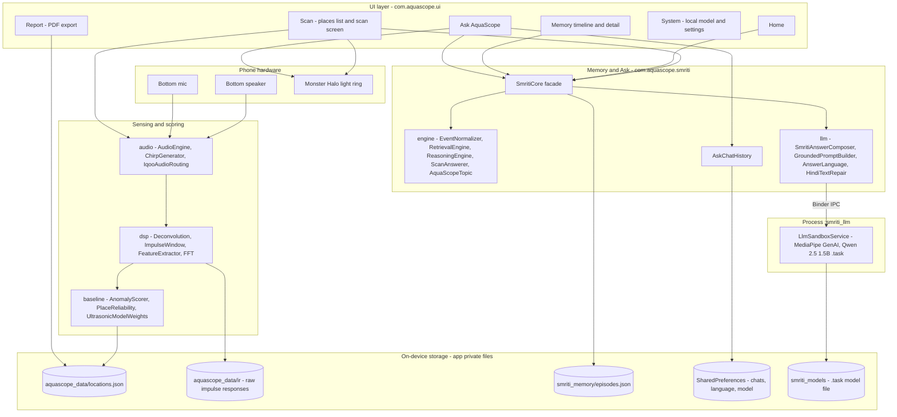
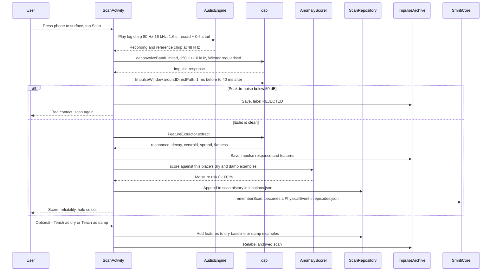
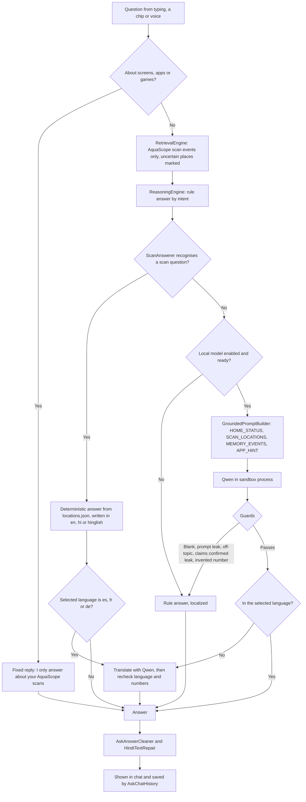

# AquaScope technical architecture

AquaScope turns an Android phone into a contact acoustic sensor for hidden dampness and leaks. The phone's bottom speaker plays a chirp into a wall or pipe, and the bottom mic records the response. The app recovers the surface's impulse response, extracts five acoustic features, and scores them against dry and damp examples the user taught at that place. Everything runs on the phone: sensing, scoring, memory and the Ask assistant. No data leaves the device.

The target device is the iQOO 15 (Snapdragon 8 Elite Gen 5, 48 kHz audio). The app is a single Android application, `:app` (package `com.aquascope`, Kotlin, minSdk 26, targetSdk 34).

## 1. System overview

## 2. Scan pipeline

A scan is one chirp played and recorded at the same time. The timing has to line up, because deconvolution divides the recording by the known chirp.

### Audio capture (`com.aquascope.audio`)

- `IqooDeviceProfile` fixes the sample rate (48 kHz preferred, then 44.1 kHz and 16 kHz) and the chirp band, length and tail.
- `IqooAudioRouting` sends the chirp only to the bottom-firing speaker (the right channel in portrait) and records from the bottom primary mic. Echo cancellation, noise suppression and automatic gain are turned off so the recording stays raw.
- `ChirpGenerator` builds the logarithmic sweep. `AudioEngine` plays it and records at the same time.

### Signal processing (`com.aquascope.dsp`)

- **`Deconvolution`:** frequency-domain division of the recording by the chirp, limited to 150 Hz–10 kHz, with Wiener regularisation so near-zero bins don't blow up. The result is the surface's impulse response.
- **`ImpulseWindow`:** cuts the response to the direct echo, from 1 ms before the peak to 40 ms after, with a 2 ms fade. It rejects scans whose peak is less than 50 dB above the noise, which usually means poor contact. Measured over the whole response, the features mostly describe room noise.
- **`FeatureExtractor`:** five features within 200 Hz–8 kHz.

| Feature | What hidden water changes |
|---|---|
| Resonance peak (Hz) | Added mass lowers the dominant mode |
| Decay time (Hilbert envelope) | Damping shortens ringing |
| Spectral centroid | Energy shifts toward low frequencies |
| Spectral spread | Bandwidth of the response |
| Spectral flatness | Tonal versus noise-like response |

- **`FFT`:** a pure-Kotlin radix-2 Cooley–Tukey transform with no native dependency.

Each saved example records `FEATURE_VERSION` (currently 2: band-limited deconvolution plus the 40 ms window), so examples from older pipelines aren't mixed with new ones.

### Scoring and trust (`com.aquascope.baseline`)

`AnomalyScorer` turns features into a 0–100 % moisture risk for one place.

- **Dry baseline only:** a weighted distance from the dry examples. The weights come from `UltrasonicModelWeights`, loaded from `assets/ultrasonic/trained_weights.json` and trained offline.
- **Dry and damp examples:** a hybrid. Half of the score is a 1-D linear discriminant (LDA) along the dry-to-damp axis, after removing duplicate and outlier examples, calibrated so the dry reference maps to about 22 % and the damp reference to about 78 % (`calibratedPercent`). The other half is the scan's relative distance to the dry and damp centres (standardised features). Damp at 50 % or more.
- **Per-place features:** with at least 3 dry and 3 damp examples, the place uses whichever of the 31 combinations of the five features separates its own examples best (10-fold cross-validation); otherwise all five. Selections and self-checks are cached per set of taught examples and warmed in the background at app start.
- **Accuracy:** on the recorded dataset this lifts the mean per-place self-check from 59 % to 72 % (`tools/hybrid_check.py`, which mirrors the app code exactly).
- **Bands:** green ≤ 30 %, yellow ≤ 70 %, red above 70 %. The halo turns high at 50 %.

`PlaceReliability` decides whether a place's score can be believed, and the scan screen, Home, Memory and Ask all use it:

| Level | Meaning |
|---|---|
| `NO_BASELINE` | No dry examples yet |
| `PRELIMINARY` | Fewer than 2 damp examples |
| `NOT_CHECKED` | Fewer than 3 examples of each kind, so no self-check is possible |
| `UNRELIABLE` | Leave-one-out self-check below 70 %: dry and damp sound alike here |
| `RELIABLE` | Self-check at least 70 % |

`AnomalyScorer.teachingSelfCheck` runs the self-check: it holds out each taught example, picks the features again from the rest, and checks whether they classify it correctly (balanced accuracy). Anomaly events from places that aren't `RELIABLE` are shown as "Can't tell yet" and never raise alerts.

## 3. Memory

`SmritiCore` is the single entry point above sensing.

- `EventNormalizer` turns each scan or baseline save into a `PhysicalEvent`, with an event type (NORMAL, ACOUSTIC_DEVIATION, REPEATED_ANOMALY, POSSIBLE_LEAK and others), the score, the place and a plain-language summary. Memory never records a *confirmed* leak; only the user can confirm one.
- `EpisodicMemoryStore` appends events to `files/smriti_memory/episodes.json`. Home, the Memory timeline and Ask all read from this file.
- `homeMemorySnapshot` and `homeStatusSummary` build the Home screen's place nodes and status line, and leave out uncertain readings.

## 4. Ask AquaScope

Ask answers questions about your places and scans, and nothing else. It answers from your scan data first and uses the local language model only to phrase general answers or to translate.

Key design decisions:

- **Scan answers skip the model.** Questions like "which places are damp?" or "when did I last scan table2?" come straight from `ScanAnswerer`. A 1.5B model rewrote correct numbers into wrong ones, so it never sees these.
- **Grounding guards.** A model reply is thrown away and the rule answer used instead if it:
  - is blank or leaks the prompt,
  - mentions screens, apps or games (`AquaScopeTopic`),
  - claims a confirmed leak the evidence doesn't support,
  - contains any number of two or more digits that isn't in the prompt (`numbersGrounded`).
- **Language.**
  - Supported languages: English, Hindi (Devanagari), Hinglish, Spanish, French and German. "Auto" follows the language of the question.
  - `AnswerLanguage` detects the language of a reply from its script and common words. A reply in the wrong language is translated by the model, and the translation must pass the same language and number checks.
  - The Ask screen's own labels follow the selected language for English, Hindi and Hinglish.
- **Hindi repair.** `HindiTextRepair` fixes broken model Hindi with rules:
  - turns byte-garbled Devanagari back into proper letters,
  - rejoins vowel signs split from their letters and removes orphaned or repeated ones,
  - removes stray zero-width characters,
  - fixes "।" punctuation,
  - corrects a dictionary of common misspellings.
- **Chat history.** `AskChatHistory` keeps conversations in SharedPreferences, up to 500 questions. The Chats list groups them by day, and a new chat starts after 6 hours of inactivity.

### Local model sandbox

- **Separate process.** `LlmSandboxService` runs in its own process (`:smriti_llm`) and hosts MediaPipe GenAI with whichever `.task` model is installed. On the test phone that is Qwen 2.5 1.5B Instruct (INT8). `IsolatedLlmClient` talks to it over Binder.
- **Crash isolation.** A native crash in the model kills only the sandbox process. Ask falls back to rule answers, and scanning is unaffected.
- **Getting the model.** `LocalModelStore` and `ModelDownloadService` download or import model files. `LocalModelActivity` (the System tab) shows the model's status and lets you reload it.
- **Prompt size.** Prompts are kept short because the model's context window is small. At most 8 places go into the prompt, and the most relevant ones come first.

## 5. Monster Halo

The ring light around the rear camera shows the app's state:

| Colour | State |
|---|---|
| Cyan | Normal |
| Amber pulse | Anomaly under 50 % |
| Amber-red chase | Anomaly at 50 % or more |
| Teal | Recalling memory |
| White | Unknown |

How it works:

- `SmritiLightMapper` maps scan and Ask results to a `SmritiLightState`.
- `MonsterHaloController` drives the light through `VivoLightServiceClient`, a Binder client for the vendor light service. It needs `hiddenapibypass` to reach that service on Android 9 and later.
- `HaloIndicatorView` mirrors the light on screen for phones without the hardware.

## 6. Reports

`ReportGenerator`, `ReportChartRenderer` and `PdfSessionReportWriter` build a PDF of a session from `locations.json`:

- the places with their scores and reliability,
- score charts,
- guidance from `IndianComplianceGuidelines`.

`ReportPdfExporter` shares the PDF through a `FileProvider`.

## 7. Offline tools (`tools/`)

| Script | Purpose |
|---|---|
| `export_dataset.py --pull` | Pull `locations.json` and the impulse archive from the phone over adb and write `data/ultrasonic/dataset/all_samples.csv` |
| `train_ultrasonic_scorer.py` | Fit feature weights and write `trained_weights.json` |
| `train_shared_model.py` | Experiment with a model shared across places |
| `evaluate_extra_features.py` | Test candidate features on the archived impulse responses |
| `dsp_reference_sim.py` | Reference simulation of the DSP chain |

## 8. Process and threading model

- **Main process (`com.aquascope`):**
  - The UI runs on the main thread.
  - Audio capture and DSP run on background coroutines (`Dispatchers.Default` or `IO`).
  - `SmritiCore` is a process-wide singleton.
- **Sandbox process (`:smriti_llm`):** model loading and text generation, with nothing else.
- **Storage:** JSON files and SharedPreferences under app-private storage. `smriti_brain.db` (Room) remains from the older screen-memory feature; Ask no longer reads it.

## 9. Code map

| Package | Responsibility |
|---|---|
| `audio` | Chirp generation, simultaneous play and record, iQOO speaker and mic routing |
| `dsp` | FFT, deconvolution, echo windowing, feature extraction |
| `baseline` | Moisture scoring, self-check, place reliability, trained weights |
| `data` | `ScanRepository` (`locations.json`), `ImpulseArchive` (raw impulse responses) |
| `smriti` | `SmritiCore` facade, `AskChatHistory` |
| `smriti.engine` | Event normalising, retrieval, rule reasoning, scan answers, topic check |
| `smriti.memory` | `EpisodicMemoryStore` (`episodes.json`) |
| `smriti.llm` | Prompt building, answer composing and guards, language detection and translation, Hindi repair, model sandbox, model downloads, Whisper voice |
| `smriti.skills` | Optional markdown agent skills from `assets/skills` |
| `halo` | Monster Halo state mapping and vendor light service client |
| `report` | PDF session report |
| `ui` | Activities and custom views |

### Other modules

Gradle also builds these modules, but they are not on the scan or Ask path:

- `:smriti-aqua`: a standalone native (C++ / KISS FFT) DSP lab, opened from the navigation menu.
- `:smriti-core`, `:smriti-app`, `core-*`, `feature-*`: earlier Smriti experiments.
- `screenmind/`: a separate Python desktop project.

Ask does not use any screen-memory code.
